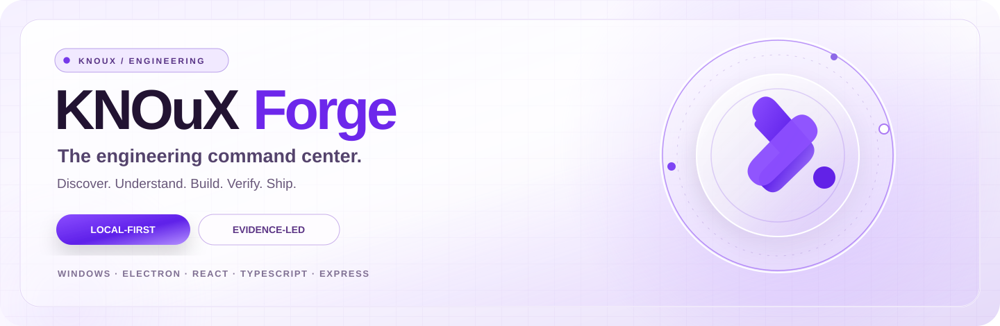
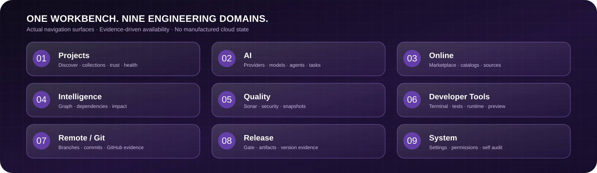
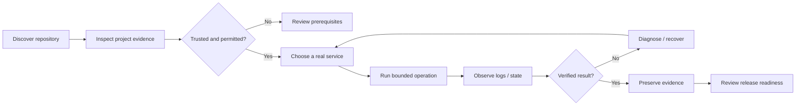
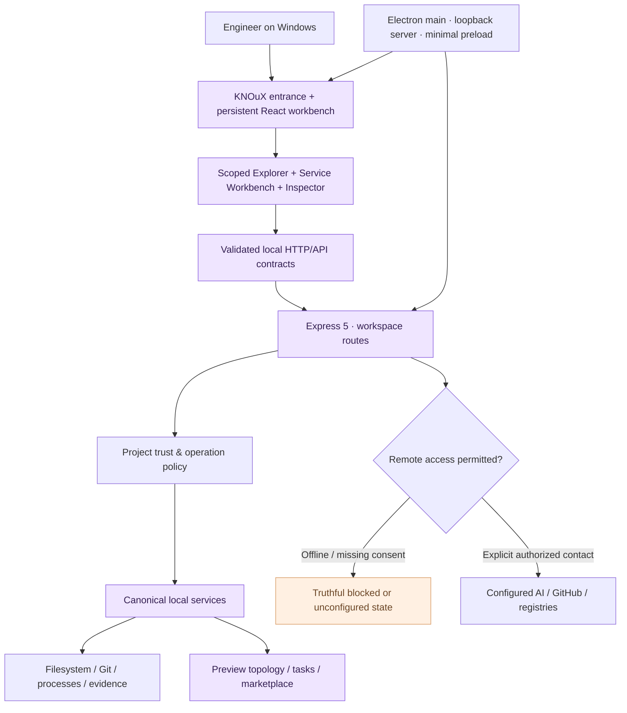
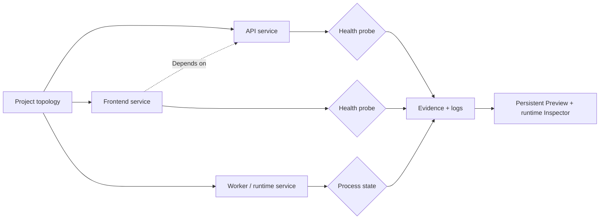
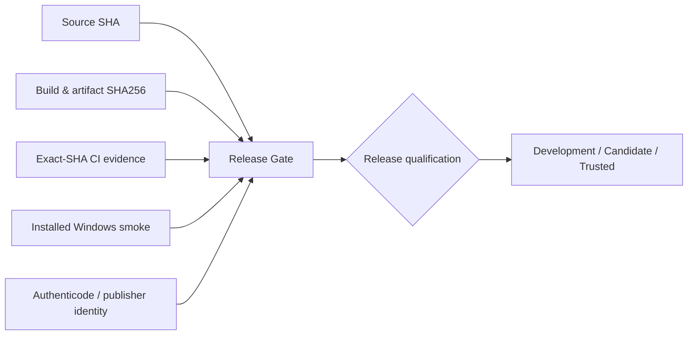

<div align="center">


<br />



### The engineering command center for the work you actually ship.

**One deliberate workspace. Real project evidence. Explicit execution. Honest results.**

[](docs/DESKTOP_ARCHITECTURE_DECISION.md)
[](desktop/)
[](client/)
[](package.json)
[](server/)
[](LICENSE)

[](https://github.com/daynightae-cmyk/KForge/actions/workflows/kforge-verification.yml)
[](docs/SIGNING.md)
[](docs/KFORGE-CAPABILITY-MATRIX.md)

**[Get started](#quick-start)** · **[Explore the workbench](#one-workbench-nine-engineering-domains)** · **[See the architecture](#architecture--trust-boundaries)** · **[Desktop & Windows](#windows-desktop--installer)** · **[Verification](#verification--quality-gates)** · **[Documentation](#documentation--engineering-evidence)**

<sub>By <a href="https://knoux.store/">KNOUX</a> · Founder &amp; Software Engineer: <b>Eng. Sadek Elgazar</b> · Built for serious engineering, not fictional dashboards.</sub>

</div>

---

> [!IMPORTANT]
> **Engineering truth is a product feature.** KForge is undergoing active product completion. A rendered panel is not proof of a working service; a passing test is evidence for its **exact commit and tested scope**, not blanket production certification. Remote providers, CI status, installer trust, marketplace registries and AI executions must be backed by their own real evidence. See the [capability matrix](docs/KFORGE-CAPABILITY-MATRIX.md), [current status](PROJECT_STATUS.md), [security policy](SECURITY.md) and [latest CI runs](https://github.com/daynightae-cmyk/KForge/actions/workflows/kforge-verification.yml).

## At a glance

KNOuX Forge (KForge) is a **local-first Windows engineering workbench** designed to make complex software projects understandable, operable and verifiable from one coherent interface. It combines repository discovery, project intelligence, controlled command execution, AI/provider and agent orchestration, Preview topology, Git evidence, quality analysis and Windows release qualification.

Unlike a thin collection of buttons, its intended operating contract is deliberately explicit:

**Discover → Understand → Review authority → Execute → Observe result → Verify → Preserve evidence.**

The application combines a **React 18 / TypeScript / Vite frontend**, an **Express 5 backend** and a **Windows Electron desktop shell**. Its local-first architecture allows useful engineering work without turning a page visit into an automatic cloud request.

### What makes Forge different?

| Principle | What it means in the product |
|:---|:---|
| **Local-first control** | Your selected project, its files, Git metadata, process state and workspace evidence are the primary context. |
| **Evidence, not decoration** | Readiness, health, provider configuration and unavailable capabilities are reported separately. |
| **One canonical shell** | Activity Bar → scoped Explorer → service-specific workspace → contextual Inspector → Persistent Preview. |
| **Explicit authority** | Trust, permission, network mode, provider disclosure and confirmation govern sensitive operations. |
| **Real project intelligence** | Bounded imports, exports, dependencies, symbols, routes, APIs, graph cycles and change impact. |
| **Owned runtime orchestration** | Preview tracks KForge-launched processes, health probes, dependencies and stop/restart scope. |
| **Release provenance** | Local code, local artifacts, GitHub/CI, installer identity and signing are independent verdicts. |
| **Honest offline behavior** | An unconfigured or unreachable external provider is not silently replaced by fake success. |
| **Preserved work** | Existing services, evidence, visual identity, settings and user data are not disposable implementation shortcuts. |

## The KNOuX Luminous Glass identity

KForge's visual direction follows its **approved pearl installation/reveal experience**: restrained lavender luminosity, layered translucent materials, clearly bounded cards, high-contrast engineering typography and a unified transition into the workbench. The **KNOuX Luminous Glass** workspace change is integrated into the mainline source; its exact design and acceptance evidence are tracked by [PR #63](https://github.com/daynightae-cmyk/KForge/pull/63).

This README's banner and domain diagram are **documentation artwork**, not simulated application screenshots. The genuine brand mark comes from the repository's own [official logo asset](client/assets/knoux-forge-official-logo.webp). Actual rendering and accessibility must always be checked in the running application and across relevant viewports, themes and interaction states.

<div align="center">



<sub>Visual map sourced from the canonical <a href="client/workbench/navigation.ts">navigation contract</a>. A destination is not automatically a configured live provider.</sub>

</div>

## Contents

<details open>
<summary><b>Explore the entire engineering guide</b></summary>

- [At a glance](#at-a-glance)
- [The KNOuX Luminous Glass identity](#the-knoux-luminous-glass-identity)
- [One workbench, nine engineering domains](#one-workbench-nine-engineering-domains)
- [The capability and service contract](#the-capability-and-service-contract)
- [A real engineering workflow](#a-real-engineering-workflow)
- [Quick start](#quick-start)
- [Windows desktop & installer](#windows-desktop--installer)
- [Architecture & trust boundaries](#architecture--trust-boundaries)
- [Preview Experience 5.0](#preview-experience-50)
- [AI, agents & provider consent](#ai-agents--provider-consent)
- [Offline, local-first & connected modes](#offline-local-first--connected-modes)
- [Marketplace & ecosystem intelligence](#marketplace--ecosystem-intelligence)
- [Quality, security & observability](#quality-security--observability)
- [Verification & quality gates](#verification--quality-gates)
- [Release evidence & signing](#release-evidence--signing)
- [Performance & accessibility](#performance--accessibility)
- [Configuration & persistence](#configuration--persistence)
- [Project layout](#project-layout)
- [Engineering status & honest limitations](#engineering-status--honest-limitations)
- [Contribution & safe development](#contribution--safe-development)
- [Documentation & engineering evidence](#documentation--engineering-evidence)
- [Corporate identity & contact](#corporate-identity--contact)

</details>

## One workbench, nine engineering domains

The [canonical navigation source](client/workbench/navigation.ts) currently defines **9 Activity Bar domains and 68 user-facing destinations**. The [service directory](client/workbench/serviceDirectory.ts) attaches domain, section, purpose, primary action, handler and API contract to navigable services; [availability](client/workbench/serviceAvailability.ts) is computed from real prerequisites and evidence, not hardcoded success.

These are *product areas and reachable destinations*, **not a claim that 68 independent external integrations are live**.

### 01 — Projects · local context and collections

**Workspace · Project Health · Recent · Favorites · Pinned · Archive · Open Project · Import Project**

Start with real project context: inspect a local repository, choose the active project, review trust, open a directory or request a permitted clone. Organize known projects using persisted collections, then let the project's actual technology and metadata determine which capabilities are available.

- Bounded local project discovery and selection.
- Project-specific health, findings and evidence.
- Recent/favorite/pinned/archive collections.
- Distinction between global context and a selected, trusted project.
- Explicit policy checks for importing or cloning a remote repository.

**Primary evidence:** [Projects source](client/workbench/projectsSurface.tsx) · [Project collections](client/workbench/ProjectCollectionsWorkbench.tsx) · [Project Health](client/workbench/ProjectHealthWorkbench.tsx)

### 02 — AI · providers, models, agents and tasks

**Providers · Models · Agents · Tasks**

The Provider Studio separates the state of an adapter from a configured credential, an actual connection test and the models that have truly been discovered. The agent/task area coordinates bounded work through explicit authority, persisted evidence, retries and failure reporting.

- Local provider discovery for compatible loopback runtimes.
- Optional configured cloud adapters, without automatic cloud selection.
- Explicit disclosure before project context leaves the machine.
- Task and mission lifecycle with evidence and recovery boundaries.
- No fabricated completion, model capability, token usage or provider health.

**Primary evidence:** [Provider Studio](client/workbench/ProviderStudio.tsx) · [AI source](client/workbench/aiSurface.tsx) · [Security policy](SECURITY.md)

### 03 — Online · marketplaces, catalogs and integrations

**Discover · Marketplace · Extensions · Models · Agents · Tools · Integrations · Installed · Updates · Downloads · Providers · Remote Sources · Documentation · Security · Activity**

Online is a **controlled evidence surface**, not a background downloader. Browsing a catalog does not imply a remote request. Local packages and configured integrations are treated differently from remote registry records or mere search results.

- Discover and inspect catalog provenance.
- Review permissions, compatibility, security and lifecycle eligibility.
- Differentiate available local items, installed packages and remote records.
- Perform supported first-party/local Marketplace lifecycle operations.
- Refuse untrusted remote installation when package/integrity adapters are missing.

**Primary evidence:** [Online surface](client/workbench/onlineSurface.tsx) · [Marketplace audit](docs/MARKETPLACE_LIFECYCLE_AUDIT.md) · [Capability matrix](docs/KFORGE-CAPABILITY-MATRIX.md)

### 04 — Intelligence · structural understanding

**Project Graph · Dependencies · Impact Analysis · Code Understanding · Ask KForge · Architecture**

Build a traceable mental model of a repository: identify bounded sources, dependency relationships, symbols, imports/exports, routes and APIs. Explore transitive impact and architecture concerns without presenting a generated summary as exhaustive proof.

- Local graph and dependency evidence.
- Change impact and cycle exploration.
- Language-aware bounded source inspection.
- Honest coverage limits for unparsed or unsupported project structures.
- Optional AI reasoning only when the required provider and user consent exist.

**Primary evidence:** [Intelligence surface](client/workbench/intelligenceSurface.tsx) · [Capability matrix](docs/KFORGE-CAPABILITY-MATRIX.md)

### 05 — Quality · meaningful findings and recovery

**KForge Sonar · Problems · Solutions · Security · Performance · Technical Debt · Documentation · Snapshots**

Quality work is driven by observed findings, supported fixes, confirmation and re-verification. The same product surface should never manufacture vulnerability counts, debt scores or remediation success.

- Run supported project-health checks through explicit authority.
- Triage real findings and review deterministic correction previews.
- Keep security scanner/tool availability visible.
- Review documentation consistency and safe corrections.
- Create and inspect snapshots with scoped recovery behavior.

**Primary evidence:** [Quality source](client/workbench/qualitySurface.tsx) · [Security Workbench](client/workbench/SecurityQualityWorkbench.tsx) · [Snapshot Recovery](client/workbench/SnapshotRecoveryWorkbench.tsx)

### 06 — Developer Tools · execution, tests and Preview

**Terminal · Tests · Build · Runtime · Lint · Logs · Diagnostics · Preview**

Developer tools use registered project commands and bounded execution state, rather than assuming any arbitrary text can be safely run. Preview is a KForge-owned runtime with lifecycle, health, dependency and log evidence.

- Discover project-declared commands without executing them.
- Review authority before invoking tests/build/lint/runtime operations.
- Attribute output, exit/failure information and recent execution evidence.
- Manage real runtime Preview sessions and specialized topology workbenches.
- Keep the Persistent Preview dock contextual instead of permanently obstructing the workspace.

**Primary evidence:** [Developer source](client/workbench/developerSurface.tsx) · [Preview Studio](client/workbench/PreviewStudioWorkbench.tsx) · [Topology Lab](client/workbench/TopologyLab.tsx)

### 07 — Remote / Git · provenance before remote claims

**Git · Branches · Commits · GitHub · Pull Requests · Issues · Actions · Releases**

Local Git is valuable even when GitHub is offline. KForge keeps repository working-tree facts distinct from remote PR/CI/release evidence and gates remote actions behind deliberate connectivity and permissions.

- Inspect local status, branches, commits and working-tree context.
- Review supported Git operations under project trust.
- Represent unavailable remote PRs/checks/releases truthfully.
- Avoid treating a local commit or test as proof of GitHub CI completion.
- Make remote contact and operations explicit.

**Primary evidence:** [Remote/Git source](client/workbench/remoteSurface.tsx) · [GitHub Workbench](client/workbench/GitHubRemoteWorkbench.tsx)

### 08 — Release · evidence-qualified distribution

**Release Gate · Release Preparation · Artifacts · Versioning**

A Windows installer existing on disk does not establish its trust. KForge keeps source revision, built artifact, checksum, CI provenance, installer lifecycle and publisher signing independent, so release readiness is not inferred from one green test.

- Verify version and artifact consistency.
- Keep local artifact presence separate from CI-produced binaries.
- Review Release Gate evidence for each source.
- Distinguish development packages from trusted, signed releases.
- Preserve user data and avoid accidental publication.

**Primary evidence:** [Release source](client/workbench/releaseSurface.tsx) · [Release Distribution Workbench](client/workbench/ReleaseDistributionWorkbench.tsx) · [Signing contract](docs/SIGNING.md)

### 09 — System · policy, preferences and diagnostics

**Settings · Trust · Permissions · Storage · Online / Offline · Self Audit · System Diagnostics**

System is the trust and truth control plane. User-editable settings are persisted; unsupported settings are clearly identified. Trust and remote mode decisions change actual permissions rather than merely changing decorative badges.

- Configure editable application preferences.
- Inspect project trust and explicit execution permissions.
- Control offline/network policy.
- Review application storage and diagnostics.
- Run bounded Self Audit with persisted evidence and honest restart/reload verification.

**Primary evidence:** [System source](client/workbench/systemSurface.tsx) · [System Control Center](client/workbench/SystemControlCenter.tsx) · [System Trust](client/workbench/SystemTrustCenter.tsx)

## The capability and service contract

The foundational information model is:

```text
ACTIVITY BAR
  └── DOMAIN (9)
       └── EXPLORER SECTION
            └── SERVICE DESTINATION (68 entries in current navigation)
                 ├── Purpose & prerequisites
                 ├── Primary action
                 ├── UI handler
                 ├── Real API contract
                 ├── Availability evidence
                 └── Result / error / recovery feedback
```

This is enforced and described by [Service Directory](docs/KFORGE-SERVICE-DIRECTORY.md) and the [service-directory tests](client/workbench/serviceDirectory.spec.ts). The shared [service card](client/components/ui/KForgeServiceCard.tsx) and [capability card](client/components/ui/KForgeCapabilityCard.tsx) convey identity, outcomes, availability, prerequisites and real operation feedback.

A **service card is a navigation and action surface**, not independent evidence that its backend works. Service readiness depends on selected project, trust, runtime, registered actions, actual providers and network policy.

**Availability may include:** `READY`, `NEEDS_SETUP`, `REQUIRES_PROJECT`, `REQUIRES_PERMISSION`, `OFFLINE`, `UNAVAILABLE`, `RUNNING`, `FAILED` and `COMPLETED`.

### How to distinguish a working feature from a beautiful shell

| Layer | Required proof |
|---|---|
| Entry point | The destination is reachable from the canonical navigation. |
| Interface | Visible controls are bound to real handlers and reflect actual state. |
| Contract | The handler invokes an existing, validated API or IPC capability. |
| Authority | Project trust, permissions, online policy and confirmation are applied. |
| Execution | A permitted operation reaches its real owner, without a hidden mock substitute. |
| Result | Success/error/timeout/cancellation are visible, accurate and actionable. |
| Persistence | Applicable settings, task or snapshot state survive the required restart/reload. |
| Acceptance | The exact behavior is tested on a named environment and source SHA. |

## A real engineering workflow



A typical journey begins in **Projects / Workspace**, selects a repository, examines **Intelligence / Project Graph**, runs **Developer Tools / Tests**, inspects **Quality / Problems**, starts **Preview** when the project is trusted, reviews **Remote / Git**, then qualifies a candidate in **Release Gate**.

No transition assumes that a remote provider is configured; each step exposes its own prerequisites.

## Quick start

### Prerequisites

- **Windows 10/11 x64** for the first-class installed desktop and NSIS verification path.
- **Node.js + npm**, plus **Git** for development from source.
- Optional ecosystem tools only for the language/framework of the selected project.
- Optional AI/provider credentials only for those specifically enabled integrations.
- Playwright browser dependencies for local browser E2E execution.

> [!CAUTION]
> **Existing KForge workspaces may contain uncommitted code, worktrees, stashes and concurrent agent changes.** The commands below describe a **fresh, separate development checkout**. Do not replace or reset an existing canonical workspace to follow a README quick start.

### Install dependencies

```powershell
git clone https://github.com/daynightae-cmyk/KForge.git
Set-Location KForge
npm ci
```

The project uses a committed dependency lockfile and an explicit lifecycle-script allowlist; `npm ci` must satisfy the current installed policy. Do not bypass supply-chain checks to make a build green.

### Launch the developer workspace

```powershell
# Point discovery at a parent folder containing your own projects.
$env:KFORGE_WORKSPACE_ROOT = 'D:\Projects'

npm run dev
```

The default Vite development URL is **http://localhost:8080/workspace**. The root route **/** contains the branded entrance/reveal, while **/workspace** opens the engineering application. The development port can be overridden through Vite CLI arguments.

### Run the production server locally

```powershell
npm run build

$env:KFORGE_WORKSPACE_ROOT = 'D:\Projects'
$env:PORT = '3000'

npm start
```

Open **http://localhost:3000/workspace**. The local API is mounted under `/api/workspace`; `/api/ping` is a smoke/health entry point.

### First-session checklist

1. Enter the workspace using the real KNOuX reveal.
2. Open or discover a **local** project directory.
3. Review the project's trust status.
4. Inspect its available actions before running commands.
5. Open Intelligence or Quality to understand available local evidence.
6. Only invoke Preview, Agents or remote services after their relevant authority and configuration are satisfied.

### Existing Windows development checkout

The repository also ships [`scripts/KForge-Local-Preview.ps1`](scripts/KForge-Local-Preview.ps1), a Windows launcher that can synchronize `main`, preserve local changes via its documented stash behavior, install dependencies and start a Preview session.

**Inspect that script and [RUN.md](RUN.md) before running it in a valuable working copy.** Its defaults refer to a particular historical checkout; your actual local path, branch, worktrees and active agents must be rechecked. Do not treat the launcher as a safe replacement for an unreviewed, dirty, concurrent workspace.

## Windows desktop & installer

KForge includes a real Electron shell and an **x64 NSIS per-user installer** path. The installed product supplies its own embedded runtime and application window; it does not require an end user to manually start an npm server.

```powershell
npm ci
npm run package:windows
npm run verify:desktop
npm run verify:installer
```

The packaging workflow produces installer artifacts and verification records under `release/` when its environment and gates succeed.

### Release and user-data behavior

| Area | Designed behavior |
|---|---|
| Desktop entry | [`desktop/main.cjs`](desktop/main.cjs) owns the Electron lifecycle and bundled engine. |
| Window boundary | Context-isolated renderer, no Node integration in web content, minimal preload surface. |
| Network binding | Packaged Express engine binds to loopback, not the LAN. |
| Installer | Per-user NSIS with Start Menu and Desktop shortcut contract. |
| Mutable state | Stored in user-owned application data, not written inside immutable installer resources. |
| Updates | Preserve KForge-managed settings, task state and workspace collection data. |
| Uninstall | Does **not** silently delete retained KForge-managed user data. |
| Publisher trust | A signature and its OS-verified Authenticode state must be established per artifact. |

**Do not execute the user-data purge helper casually.** [`installer/purge-kforge-user-data.ps1`](installer/purge-kforge-user-data.ps1) is intentionally separately confirmation-gated. Normal uninstall does not imply that retained personal workspace-state data should be destroyed.

### Installer trust is not a marketing badge

The [signing contract](docs/SIGNING.md) distinguishes:

- `DEVELOPMENT` — a test/dev artifact, potentially unsigned.
- `RELEASE_CANDIDATE` — engineering gates verified, but publisher signing may still be absent.
- `TRUSTED_RELEASE` — valid OS-observed Authenticode, trusted signing inputs and remaining release gates.

KForge does **not** claim Trusted Publisher or SmartScreen reputation merely because an installer exists or `signtool` ran.

## Architecture & trust boundaries

<div align="center">



</div>

### Principal layers

| Layer | Source | Responsibility |
|---|---|---|
| Routing | [`client/App.tsx`](client/App.tsx) | Branded entry and application route. |
| Persistent shell | [`client/workbench/KForgeWorkbench.tsx`](client/workbench/KForgeWorkbench.tsx) | Activity Bar, Explorer, canvas, Inspector, Preview composition. |
| Navigation and intent | [`client/workbench/navigation.ts`](client/workbench/navigation.ts) | Nine activities and their reachable destinations. |
| Service ownership | [`client/workbench/serviceDirectory.ts`](client/workbench/serviceDirectory.ts) | Service identity, UI handler, primary action and API contract. |
| Availability | [`client/workbench/serviceAvailability.ts`](client/workbench/serviceAvailability.ts) | Real evidence-driven readiness and prerequisites. |
| UI components | [`client/components/ui/`](client/components/ui/) | Shared cards, inspectors, dialogs and interaction primitives. |
| API | [`server/index.ts`](server/index.ts), [`server/routes/`](server/routes/) | Validated HTTP orchestration and product evidence. |
| Services | [`server/services/`](server/services/) | Canonical local execution, storage and evidence ownership. |
| Contracts | [`shared/`](shared/) | Renderer ↔ server types and trusted data shapes. |
| Desktop | [`desktop/`](desktop/) | Electron lifecycle, loopback hosting and preload policy. |
| Windows release | [`installer/`](installer/) · [`scripts/`](scripts/) | NSIS packaging, signing observation and verification. |
| Acceptance | [`tests/`](tests/) | Automated project, browser, security and desktop evidence. |

The [desktop decision record](docs/DESKTOP_ARCHITECTURE_DECISION.md) explains why Electron was chosen: it reuses the established Node/Express filesystem, Git, process and task services without adding a competing native implementation.

### Trust boundary essentials

- The renderer does not receive arbitrary filesystem or shell authority.
- Desktop-to-engine communication uses a bounded loopback origin.
- Project paths and command arguments require validation and containment.
- Process ownership matters: Preview does not kill arbitrary processes merely because a port is occupied.
- External destinations, credentials and source-code disclosure are gated separately.
- Sensitive evidence is redacted, and data stores are scoped to their rightful workspace/user context.

## Preview Experience 5.0

KForge's [Preview Experience 5.0 contract](docs/PREVIEW_TOPOLOGY_5.md) treats a running project as a topology of **owned, evidence-backed services**, not a collection of guessed URLs.



### Runtime behavior that matters

- Discovery from supported project scripts, bounded workspace packages and explicit `.kforge/topology.json` configuration.
- Dependency ordering only for real, valid service relationships.
- Real states such as `STARTING`, `RUNNING`, `HEALTHY`, `FAILED`, `DEGRADED` and `PORT_CONFLICT`.
- HTTP/TCP health backed by actual probes, not PID existence.
- Owned process shutdown and bounded, redacted output.
- No automatic termination of an unrelated port listener.
- No invented network waterfall, unsupported element picking, or imaginary browser traces.
- No hidden restart loop: manual restart is the documented default.

See [Preview Topology 5](docs/PREVIEW_TOPOLOGY_5.md) for an example configuration, dependency semantics, port conflict guarantees and runtime limits.

## AI, agents & provider consent

KForge treats **provider configuration**, **model discovery**, **active connectivity** and **authorized inference** as different engineering facts.

| Provider class | Examples | Truth boundary |
|---|---|---|
| Local loopback | Ollama, LM Studio, llama.cpp-compatible servers | Runtime must exist and respond locally. |
| Optional cloud | OpenAI, Anthropic, Gemini, OpenRouter | Requires real server-side configuration, policy and consent. |
| Agent missions | Registered local mission/task flows | Needs supported tools, trusted project and execution evidence. |
| Remote context | Explicit project/source disclosure | No silent upload of code, logs or private project material. |

Before sending project context off-device, the product's contract makes the **provider, destination, data classes, optional source inclusion, redaction, purpose, consent and result** visible. Missing configuration is a factual state, not a reason to substitute an automatic cloud fallback.

Agents and tasks have their own execution histories, cancellation/failure/retry constraints and evidence. This README does not claim every configured model supports every modality, tool-call mode or context window.

## Offline, local-first & connected modes

The application defaults to **Offline**. Network operations are not triggered by opening an Online or GitHub page.

| Mode | Intended authority |
|---|---|
| **Offline** | Local evidence and safe local actions; remote contact refused. |
| **Local First** | Local operation with the specifically permitted metadata-reading policy. |
| **Online Optional** | Confirmed and reviewed external transfer when needed. |
| **Online** | Explicit authorized provider refresh and connected operations. |

Changing the visible mode is not itself proof of authentication, network availability, or a successful remote request.

## Marketplace & ecosystem intelligence

KForge's Marketplace distinguishes:

```text
CATALOG RECORD
   ↓ provenance + compatibility + permissions
VERIFIED SOURCE / TRUST DECISION
   ↓ explicit permitted lifecycle action
INSTALLED LOCAL ITEM
   ↓ bounded health / execution / update / removal evidence
REAL RESULT OR HONEST BLOCKED STATE
```

The first-party/local lifecycle has dedicated evidence in [Marketplace Lifecycle Audit](docs/MARKETPLACE_LIFECYCLE_AUDIT.md). A remote registry record is **not** automatically an installed extension, compatible tool, or trustworthy execution adapter. Remote package operations remain blocked if integrity, eligibility or installer authority is unproven.

## Quality, security & observability

### Security-first engineering

KForge's environment has local files, Git credentials, executable commands, local processes, runtime logs and optional remote providers. Its security model is therefore designed to **fail closed** instead of allowing a visual card to confer authority.

- Project trust, scope and permissions are evaluated before high-impact actions.
- Arguments and paths are bounded; command invocation should avoid shell injection.
- Electron renderer/main privileges remain separated.
- API caller origin and host boundaries restrict unintended local-server access.
- Provider credentials and user data must not appear in normal logs or public reports.
- Snapshot recovery requires review and fresh authority.
- Vulnerability and dependency policy is not waived to produce a green badge.
- External providers and security scanners do not silently run when unavailable.

**Responsible security reporting:** read [SECURITY.md](SECURITY.md) before submitting a vulnerability. Avoid publishing exploitable or private details in public Issues. Verify whether GitHub's Private Vulnerability Reporting is enabled; do not assume it from the presence of `SECURITY.md`.

### Observability with provenance

A trustworthy engineering trace should answer:

1. What operation was requested?
2. Which project and trust authority did it use?
3. Which local service, process or configured provider owned it?
4. What was actually observed?
5. What failed or timed out?
6. What data was persisted or changed?
7. What evidence can establish its result on this exact revision?

**No fabricated health score, security clearance, CI green check, installer trust or provider output.**

## Verification & quality gates

The repository defines actual verification commands in [`package.json`](package.json) and its authoritative workflow in [`.github/workflows/kforge-verification.yml`](.github/workflows/kforge-verification.yml).

```powershell
npm ci
npm run typecheck
npm run lint
npm test
npm run build
npm run test:e2e
npm run verify:assets
npm run verify:gate
```

On a compatible Windows desktop test host:

```powershell
npm run verify:desktop
npm run package:windows
npm run verify:installer
```

> [!NOTE]
> `npm run verify:gate` is the aggregate repository verification path. `npm run verify:release` is broader and can include Windows packaging/installer requirements. A local host missing Playwright browser dependencies, a signing certificate or Windows packaging support should report that limitation explicitly rather than publishing an invented PASS.

### What green checks mean — and what they do not

| Evidence | Establishes | Does not establish |
|---|---|---|
| Typecheck / lint | Static correctness within the configured code rules. | Real runtime functionality. |
| Vitest | The behavior covered by specific test files. | Every user journey or external provider. |
| Playwright | Interactions, accessibility checks and page/runtime paths it actually exercised. | A production-certified installer. |
| Build | Client/server bundles were produced. | Safe OS side effects or installed behavior. |
| Desktop smoke | Specific Electron startup/IPC/runtime paths on the tested host. | Every clean Windows machine. |
| Package/installer tests | Installer lifecycle and identity on an exact artifact. | Authenticode publisher trust unless separately validated. |
| GitHub Actions | Checks associated with the exact commit SHA. | Future commits or unconfigured external integrations. |
| Visual screenshots | Appearance of the captured states/viewport. | All themes, transitions, responsive layouts and accessibility. |

**Live, SHA-scoped evidence:** [KForge Verification Gate](https://github.com/daynightae-cmyk/KForge/actions/workflows/kforge-verification.yml). Older runs listed in the repo's status documents are historical baselines, not results for today's HEAD.

## Release evidence & signing

KForge separates five domains of release truth:



A locally present installer cannot prove it came from a particular GitHub workflow. A successful CI build cannot prove a user's installed binary has a valid Authenticode signature. The product's release surfaces intentionally preserve these distinctions.

For actual modes, manifest fields and signing verification see [Windows signing](docs/SIGNING.md); for API/process/desktop threat boundaries see [Desktop Architecture](docs/DESKTOP_ARCHITECTURE_DECISION.md).

## Performance & accessibility

A premium engineering application must also feel excellent under load. KForge's visual and runtime acceptance includes these areas:

| Surface | Evaluation focus |
|---|---|
| Splash / entrance | Branded continuity, exit/Skip behavior, audio permission and reduced motion. |
| Shell / navigation | Predictable activity changes, preserved context, no lost Inspector or Preview state. |
| Glass materials | Contrast, legibility, compositing cost, sensible fallback without backdrop filtering. |
| Service cards | Density, scanning order, consistent action prominence, true disabled reasons. |
| Preview / Topology | Owned process startup, log backpressure, stable dock layout and cleanup. |
| Large repositories | Bounded scans, caching, payload size, CPU/RAM, responsiveness and cancel behavior. |
| Keyboard | Focus visibility, Escape, commands, logical tab order and dialogs. |
| Internationalization | Arabic RTL, English LTR, truncation, typography and correct bidirectional data. |
| Themes | Light, dark, persisted system theme and reduced-motion preference. |
| Release artifacts | Bundle size and installed application memory/CPU, measured against the relevant baseline. |

Measurements and evidence are in [Dynamic UI and Accessibility Audit](docs/verification/DYNAMIC_UI_AND_ACCESSIBILITY_AUDIT.md), [Large-Project Benchmark](docs/verification/LARGE_PROJECT_BENCHMARK.md) and the exact-SHA GitHub workflow. **No speed-up percentage is claimed without a before/after measurement.**

## Configuration & persistence

### Workspace discovery

`KFORGE_WORKSPACE_ROOT` identifies a **parent directory** whose immediate child repositories should be discovered. If omitted, the server uses the parent of the current working directory.

```powershell
$env:KFORGE_WORKSPACE_ROOT = 'D:\Projects'
```

The [`.env.example`](.env.example) file documents available environment variables. It is an example, **not** a file the production server automatically loads. Never commit live API tokens or credentials to an environment file tracked by Git.

### Local state

Depending on the running mode and scope, KForge manages its own state below a `.kforge` workspace/project-state directory; Windows installed mode uses user-owned application data, including `%LOCALAPPDATA%\KNOuX Forge`.

Examples of managed state include settings, trust decisions, collections, task histories, runtime evidence, caches, snapshots and Marketplace state. These are not proof that a project's source has been uploaded remotely.

### Configuration boundaries

- **Project data:** local until a permitted action specifically transfers data.
- **Credentials:** protected by appropriate server/OS boundaries; redacted from summaries.
- **Runtime commands:** discovered, then separately reviewed and executed.
- **Preview ports:** owned or explicitly unknown; never blindly taken over.
- **Remote services:** remain offline or unconfigured until the actual prerequisite exists.

## Project layout

```text
KForge/
├── client/
│   ├── App.tsx                   # Branded route entry
│   ├── assets/                   # Genuine KNOuX imagery
│   ├── pages/                    # Installation / reveal
│   ├── workbench/                # Canonical activity shell and real services
│   └── components/ui/           # Shared presentation and interaction
├── server/
│   ├── index.ts                  # Express application assembly
│   ├── routes/                   # Validated workspace API
│   └── services/                 # Project, Git, Preview and product engines
├── shared/                       # Renderer-server contracts
├── desktop/                      # Electron Windows runtime
├── installer/                    # NSIS customizations and acceptance
├── scripts/                      # Quality, package and verification tools
├── tests/                        # Browser / engineering acceptance
├── fixtures/                     # Explicit test and local marketplace fixtures
├── docs/
│   ├── readme/                   # Original GitHub-native visual assets
│   └── verification/             # Auditable technical evidence
├── .github/workflows/            # KForge Verification Gate
├── PROJECT_STATUS.md             # Historical and release progress ledger
├── SECURITY.md                   # Vulnerability disclosure and threat policy
├── AGENTS.md                     # Engineering invariants
├── RUN.md                        # Development and operations
└── README.md
```

## Engineering status & honest limitations

KForge remains an **actively developed product**. This repository deliberately differentiates a locally implemented surface from a currently available provider and an exact-SHA verified outcome.

| Domain | Truth to preserve |
|---|---|
| **Local repository/workspace** | Local discovery, project authority and persisted evidence have concrete implementation; scope and trust still apply. |
| **Service destinations** | The navigation contract currently defines 68 destinations; their individual availability is computed from prerequisites. |
| **Luminous Glass** | The accepted visual work has been merged, but that alone is not new service/runtime verification. |
| **Cloud AI** | Optional configuration and consent pathways exist; provider connection and model capability depend on real credentials and responses. |
| **Online / GitHub** | Remote reads and writes are explicit; CI, registries and remote catalog availability cannot be inferred locally. |
| **Marketplace** | First-party/local lifecycle has evidence; remote package lifecycle needs trustworthy adapters and integrity validation. |
| **Preview** | Bounded, KForge-owned process orchestration and observed health; unsupported runtime ecosystems require explicit configuration. |
| **Release** | Windows packaging path exists; signing and current artifact trust require exact-artifact evidence. |
| **CI / vulnerabilities** | Recent dependency/security work must be judged by current lockfile and exact-SHA runs, not an old vulnerability count. |
| **Production readiness** | No unconditional `100%` claim; remaining external, installation and environment-specific gates are explicit. |

**One rule:** `VERIFIED` means supported by specific evidence; `PARTIAL` means only part of the contract is proven; `BLOCKED` means a documented prerequisite prevents verification; `UNKNOWN` is not a euphemism for PASS.

## Contribution & safe development

KForge is a long-lived engineering product, not a disposable demo. Contributions should extend real canonical services, preserve trusted source and improve observable behavior without losing unique work.

### Preferred workflow

1. Read [AGENTS.md](AGENTS.md) and inspect the actual working Git tree.
2. Record `HEAD`, `origin/main`, status, open PRs, worktrees and concurrent edits.
3. Search existing architecture and historical work **before** adding a parallel feature.
4. Make a bounded change; review the exact diff and secrets.
5. Run relevant typecheck, lint, tests, build, browser and desktop checks.
6. Submit an inspectable PR, let required CI run against its actual head SHA and resolve failures.
7. Merge only verified work with authorized repository protections intact.
8. Preserve branch/worktree/stash/untracked research and local artifacts until confirmed redundant and separately approved for destructive cleanup.

### Prohibitions

- No force push, destructive history rewrite, blind `git clean` or `reset --hard`.
- No deleting unique branches, local experiments, backups or user work without examination and explicit consent.
- No mock-based production-success claims, invented cloud responses or fictional CI output.
- No weakening authorization, IPC, origin controls or release gates to silence a test.
- No visual redesign that silently removes approved KNOuX brand assets, interactions or accessibility.
- No unreviewed installer, cleanup, registry, application removal or other live OS mutations.

### Pull requests and security

Open focused changes via [Pull Requests](https://github.com/daynightae-cmyk/KForge/pulls). Use [Issues](https://github.com/daynightae-cmyk/KForge/issues) for ordinary functional bugs and feature requests; use the protected disclosure instructions in [SECURITY.md](SECURITY.md) for vulnerabilities.

## Documentation & engineering evidence

| Source | Read it for |
|---|---|
| [Run KForge](RUN.md) | How to launch the dev workspace and production server. |
| [Repository agent contract](AGENTS.md) | Canonical source, technical invariants and safe engineering behavior. |
| [Product status](PROJECT_STATUS.md) | Recorded milestone claims, historical SHAs and known limitations. |
| [Capability matrix](docs/KFORGE-CAPABILITY-MATRIX.md) | Feature-by-feature paths and evidence boundaries. |
| [Service directory](docs/KFORGE-SERVICE-DIRECTORY.md) | Exactly how navigation and service contracts map to UI and API. |
| [Desktop architecture](docs/DESKTOP_ARCHITECTURE_DECISION.md) | Electron/Express design and Windows trust boundary. |
| [Preview Topology 5](docs/PREVIEW_TOPOLOGY_5.md) | Actual runtime discovery, health and process ownership. |
| [Marketplace audit](docs/MARKETPLACE_LIFECYCLE_AUDIT.md) | Local Marketplace verification and remote limits. |
| [Signing and release modes](docs/SIGNING.md) | Artifact trust, code signing and release qualification. |
| [Security policy](SECURITY.md) | Vulnerability reporting, credential, API and filesystem safety. |
| [Acceptance gap matrix](docs/verification/POST_NSIS_GAP_MATRIX.md) | Historical installed-runtime gaps and acceptance methodology. |
| [Accessibility and dynamic UI audit](docs/verification/DYNAMIC_UI_AND_ACCESSIBILITY_AUDIT.md) | Focus, contrast, responsiveness, actual browser evidence. |
| [Performance benchmark](docs/verification/LARGE_PROJECT_BENCHMARK.md) | Bounded measurement on a defined repository fixture. |
| [CI / Actions](https://github.com/daynightae-cmyk/KForge/actions/workflows/kforge-verification.yml) | The authoritative, commit-specific current workflow results. |

<details>
<summary><b>Why older README numbers should not be copied as today's results</b></summary>

Older documentation records named baseline runs, historical branch counts, test totals and audit results. These remain valid as **dated evidence only**. Source code, dependencies, tests, workflow definitions and product designs have since changed. The current README therefore links to the live workflow and source documents instead of pinning historical `0 vulnerabilities` or an old Playwright count as universal present-tense promises.

Every release should reconcile the installed binary, lockfile, current checks, signing evidence and exact source SHA before declaring readiness.

</details>

## Corporate identity & contact

<table>
<tr>
<td width="64%" valign="top">

### KNOUX — Engineering with purpose

**KNOUX** is the engineering brand behind KNOuX Forge.

**Founder & Software Engineer:** **Eng. Sadek Elgazar** (م. صادق الجزار)

Software architecture · Windows desktop products · Full-stack engineering · AI automation · Developer tooling · Premium product experience.

**Official corporate channels**

- **Website:** [knoux.store](https://knoux.store/)
- **Email:** [admin@knoux.store](mailto:admin@knoux.store)
- **Telephone:** [+971 50 328 1920](tel:+971503281920)
- **WhatsApp:** [Contact KNOUX](https://wa.me/971503281920)

</td>
<td width="36%" valign="top">

### Find us

- [KNOUX on GitHub](https://github.com/knoux-io)
- [Engineering GitHub](https://github.com/daynightae-cmyk)
- [KNOUX Facebook](https://www.facebook.com/knouxStore/)
- [Founder's Facebook](https://www.facebook.com/CopSadek)
- [KNOUX TikTok](https://www.tiktok.com/@knoux_7)

**Project links**

- [Source repository](https://github.com/daynightae-cmyk/KForge)
- [Issues](https://github.com/daynightae-cmyk/KForge/issues)
- [Pull requests](https://github.com/daynightae-cmyk/KForge/pulls)

</td>
</tr>
</table>

---

<div align="center">

**KNOuX FORGE**

*Engineering is not a luxury. It's a life.*

**DISCOVER · UNDERSTAND · EXECUTE · VERIFY · SHIP**

[](https://knoux.store/)

<sub>© 2026 KNOUX · Developed by Eng. Sadek Elgazar · MIT-licensed repository source subject to <a href="LICENSE">LICENSE</a>. Product runtime and release readiness always require independent verification.</sub>

</div>
